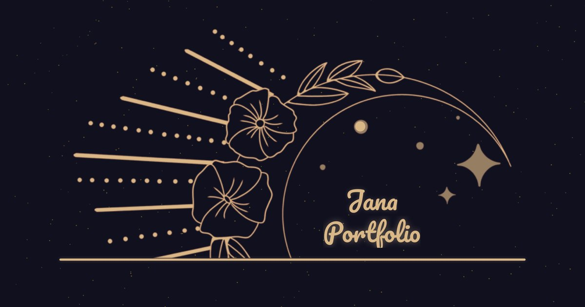

<div align="center">

# Jana's Portfolio

**Software engineer · UX/UI designer · Web & game developer**

[**View the live site →**](https://j29-h.github.io/)

[](https://j29-h.github.io/)

</div>

## About

My personal portfolio, designed in Figma and built by hand with plain HTML, CSS and JavaScript. It plays like a small journey through space: a moon-and-flowers splash, an intro that orbits through my four areas of work, and a deck of tarot-style cards for each category that opens into a full case study for every project.

## Featured work

| Category | Project | What it is | Links |
| --- | --- | --- | --- |
| Game | **Recycling Kingdoms** | Augmented-reality game that teaches children to sort waste and recycle | — |
| Game | **The Patient** | Short psychological-horror mini-game in a low-poly, PS1 style (Unity) | [itch.io](https://leenaalthekair.itch.io/the-patient-tpg) |
| Web | **NBA** | Sports website powered by the NBA API: teams, rosters and insights | [GitHub](https://github.com/J29-h/NBA-API) |
| Web | **Plants & Gardening** | Plant-knowledge platform with accounts and listings (Node, Express, MySQL) | — |
| UX / UI | **Ana Huna** | iPad app that helps non-speaking children communicate | [App Store](https://apps.apple.com/sa/app/ana-huna-%D8%A7%D9%86%D8%A7-%D9%87%D9%86%D8%A7/id6756348723) · [Behance](https://www.behance.net/gallery/247693273/Anna-Huna-Case-Study) |
| UX / UI | **Abyan Capital** | Case study redesigning three key features of an investment app | [Behance](https://www.behance.net/gallery/247694055/Abyan-Case-Study) |
| Programming | **Taptical** | iPhone game that turns overthinking into clear, manageable steps | — |

## Highlights

- **One design, every screen.** The 1440 × 1024 Figma canvas scales to fit any window, and phones get their own portrait layout.
- **Motion with purpose.** Animated splash, page-to-page transitions, scroll reveals, flip cards and a cinematic trailer hero, all CSS and GPU-friendly.
- **Accessible.** Keyboard navigation, screen-reader labels, and a calm, still version for anyone who has *reduce motion* turned on.
- **No build step.** No frameworks or bundlers: open `index.html` and it runs.

## Built with

HTML5 · CSS3 · vanilla JavaScript · Figma · Google Fonts (Pacifico, Prompt, Righteous) · hosted on GitHub Pages

## Project structure

```
index.html      all screens: splash, intro, home, about, my work, contact
styles.css      layout, themes and every animation
script.js       screen navigation, scaling, the project viewer
projects.js     the case-study content and page templates
assets/         artwork, icons, project images and videos
404.html        "lost in space" page for broken links
```

## Run it locally

```bash
git clone https://github.com/J29-h/J29-h.github.io.git
cd J29-h.github.io
python3 -m http.server 8000
```

Then open <http://localhost:8000>.

## Credits

- Basketball photo on the NBA case study by Kylie Osullivan on [Unsplash](https://unsplash.com/photos/BfaBLVCBTI8).
- All other artwork, screenshots and project media are my own or from the projects I worked on with my teams.

## Contact

[LinkedIn](https://www.linkedin.com/in/jana-malibari-) · [GitHub](https://github.com/J29-h) · [Portfolio](https://j29-h.github.io/)

---

© Jana Malibari. All rights reserved. The code and content in this repository are shared for viewing only; please don't reuse the designs, artwork or text without permission.
